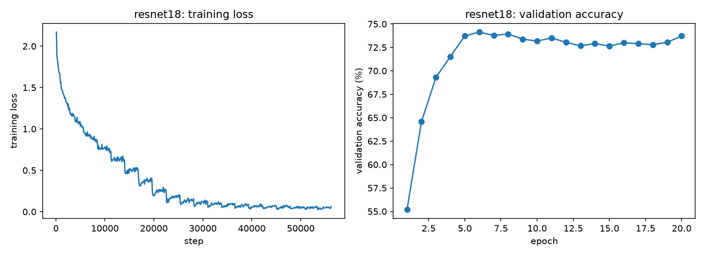
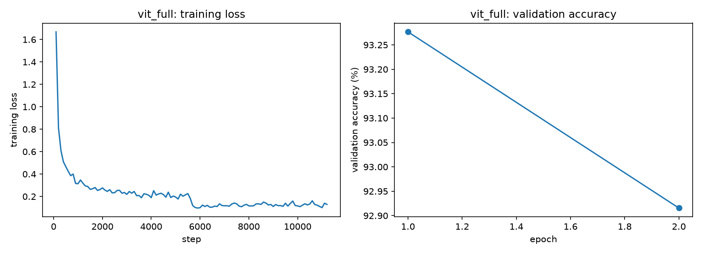
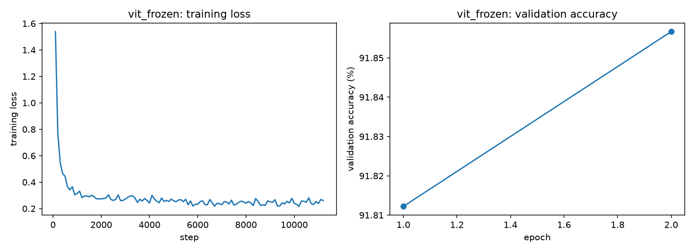
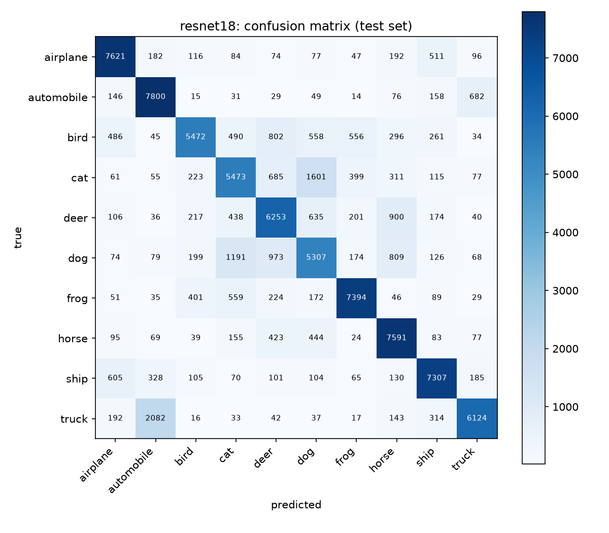
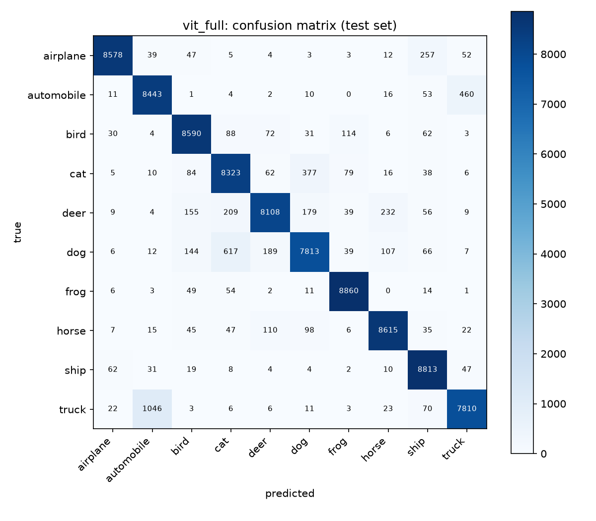
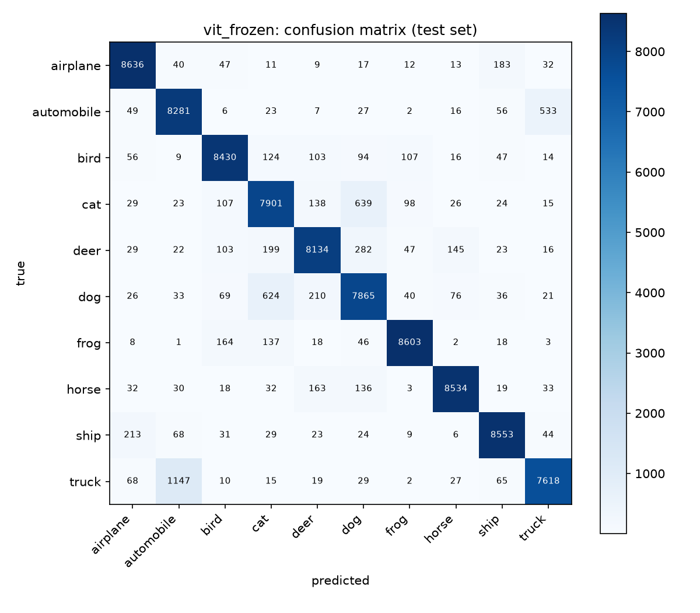
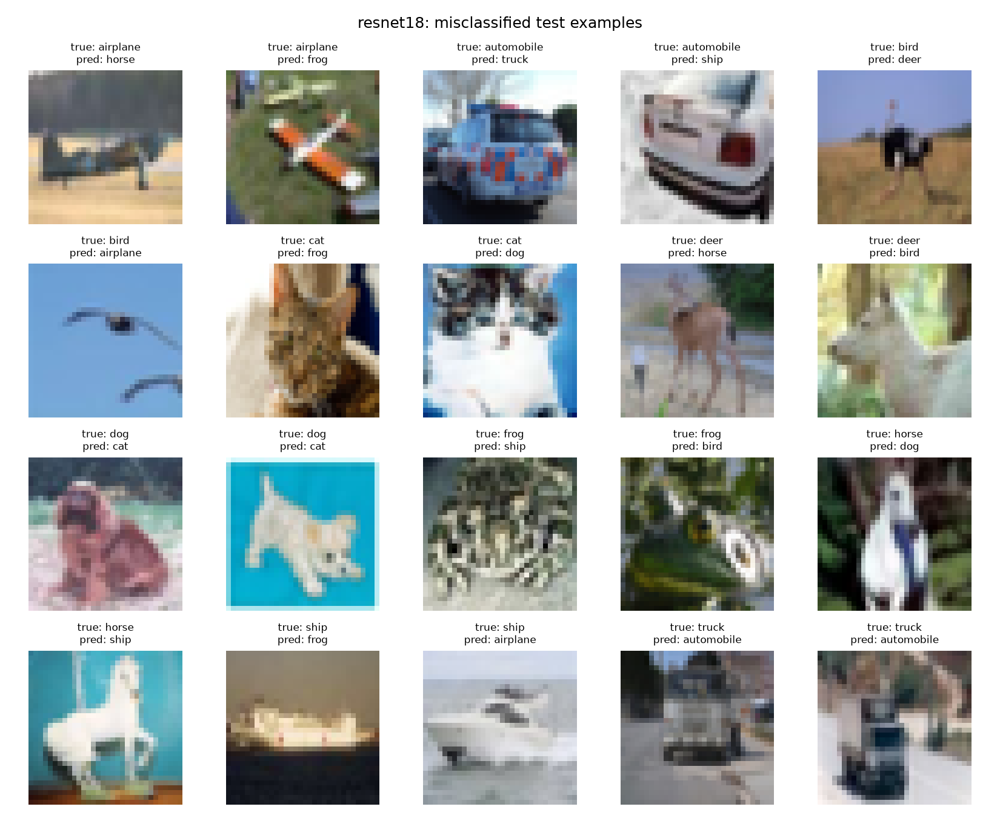
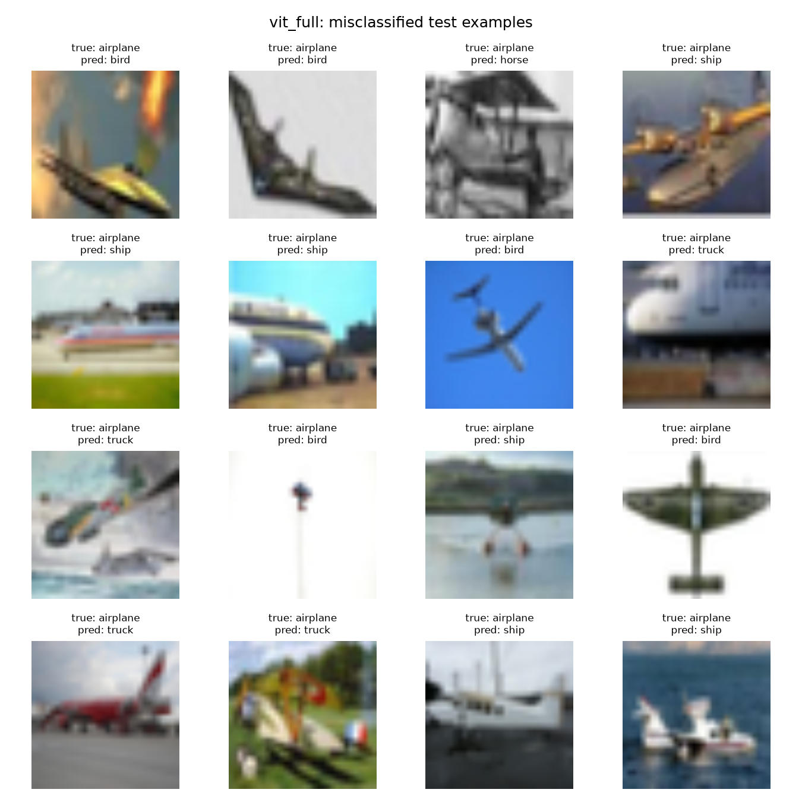
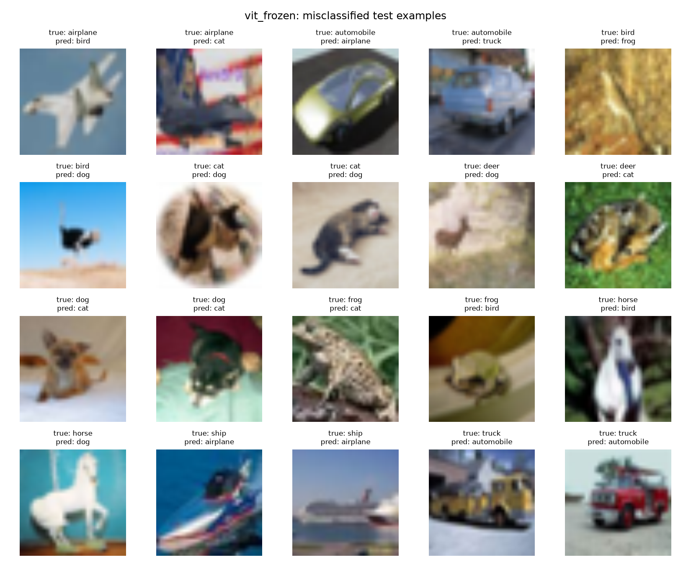

# CSCI 677 — Homework 3: Image Classification with ResNet-18 and ViT

**Name:** Abhijay Desai
**Date:** October 2026

## 1. Setup

**Dataset.** CINIC-10: 270,000 32×32 images in 10 classes, split evenly into
train/valid/test (90,000 each). Loaded with `torchvision.datasets.ImageFolder`.
ResNet inputs use the normalization constants from the assignment; ViT inputs
are resized to 224×224 and normalized with mean = std = 0.5, matching the
preprocessing the `google/vit-base-patch16-224-in21k` checkpoint was
pretrained with.

**Hardware.** Apple M1 Pro (16 GB), PyTorch `mps` backend.

**Experiments.**

| | ResNet-18 | ViT full fine-tune | ViT frozen-head |
|---|---|---|---|
| Initialization | from scratch | `google/vit-base-patch16-224-in21k` | same |
| Trainable params | 11,173,962 | 85,806,346 | 7,690 (head only) |
| Input size | 32×32 | 224×224 (upsampled) | 224×224 (upsampled) |
| Epochs | 20 | 2 | 2 |
| Batch size | 32 | 16 | 16 |
| Optimizer | Adam (β₁=0.9, β₂=0.999) | Adam | Adam |
| Learning rate | 1e-3 | 5e-5 | 1e-3 |
| Loss | cross-entropy | cross-entropy | cross-entropy |
| Training time | 67 min | 179 min | 90 min |

**Note on ViT learning rate.** The suggested 1e-3 is used for ResNet and for the
frozen-head variant, but full fine-tuning used 5e-5. When every weight is
trainable, a step size of 1e-3 is large relative to the scale of the
pretrained transformer weights, and the early updates (driven by gradients
from a randomly initialized head) can overwrite the pretrained features before
the head has learned anything useful. Learning rates around 1e-5 to 1e-4 are
the standard choice for fine-tuning ViT/BERT-style models for this reason. In
the frozen-head variant the backbone cannot change, so the larger 1e-3 rate
only affects the linear head and is safe. (Full fine-tuning at 1e-3 was not
run, so this choice is based on standard practice rather than a measured
comparison.)

**ResNet-18 architecture.** Implemented layer by layer per Figure 1 of the
assignment: 3×3/s1 stem (64 ch), four stages of two BasicBlocks each
(64/128/256/512 ch), stride-2 convolutions with 1×1-conv+BN shortcuts in the
first block of stages 2–4, global average pooling, FC 512→10. Verified stage
output shapes 32→16→8→4 and parameter count against the reference.

## 2. Training curves and validation accuracy

### ResNet-18



Validation accuracy by epoch (best **74.13%** @ epoch 6):

| Epoch | 1 | 2 | 3 | 4 | 5 | 6 | 10 | 15 | 20 |
|---|---|---|---|---|---|---|---|---|---|
| Val acc (%) | 55.19 | 64.57 | 69.30 | 71.52 | 73.73 | **74.13** | 73.18 | 72.64 | 73.71 |

Validation accuracy rises quickly over the first five epochs and peaks at
74.13% in epoch 6. From then on it stays flat or drifts down slightly (72.6–73.9%
over epochs 7–20), while the training loss keeps falling: the mean training
loss per epoch goes from 1.50 (epoch 1) to 0.50 (epoch 6) to 0.045 (epoch 20).
This widening gap between a near-zero training loss and a stagnant validation
accuracy is classic overfitting: after about epoch 6 the network is memorizing
the training set rather than learning features that generalize. This is
expected in the main setting, which uses no data augmentation, no weight decay
and a constant learning rate. Because the checkpoint with the best validation
accuracy is kept, the test results below use the epoch-6 weights.

### ViT (full fine-tune)



| Epoch | 1 | 2 |
|---|---|---|
| Val acc (%) | **93.28** | 92.92 |

The pretrained ViT already reaches 93.28% validation accuracy after one epoch,
which is 19 points above the best ResNet epoch. In epoch 2 the mean training
loss halves (0.30 → 0.12), but validation accuracy drops slightly to 92.92%.
With only two points this is weak evidence, but it is consistent with the full
model starting to fit the training set more closely than is useful: with 86M
trainable parameters, one pass over 90,000 images is already enough to adapt
it. The epoch-1 checkpoint is used for testing.

### ViT (frozen body, head only)



| Epoch | 1 | 2 |
|---|---|---|
| Val acc (%) | 91.81 | **91.86** |

With only the 7,690-parameter linear head trainable, the model reaches 91.81%
after one epoch and gains just 0.05 points in the second, while the mean
training loss falls more slowly than in full fine-tuning (0.32 → 0.24). A
linear classifier on fixed features has little capacity to overfit, so
training is stable but also saturates quickly: the ceiling is set by how
linearly separable the frozen ImageNet-21k features are for CINIC-10.

## 3. Test results

Overall top-1 test accuracy (90,000 test images):

| Model | Test accuracy |
|---|---|
| ResNet-18 (scratch) | 73.71% |
| ViT full fine-tune | **93.28%** |
| ViT frozen-head | 91.73% |

### Per-class accuracy

| Class | ResNet-18 | ViT full | ViT frozen |
|---|---|---|---|
| airplane | 84.68 | 95.31 | 95.96 |
| automobile | 86.67 | 93.81 | 92.01 |
| bird | 60.80 | 95.44 | 93.67 |
| cat | 60.81 | 92.48 | 87.79 |
| deer | 69.48 | 90.09 | 90.38 |
| dog | 58.97 | 86.81 | 87.39 |
| frog | 82.16 | 98.44 | 95.59 |
| horse | 84.34 | 95.72 | 94.82 |
| ship | 81.19 | 97.92 | 95.03 |
| truck | 68.04 | 86.78 | 84.64 |

### Confusion matrices





Largest off-diagonal confusions (true→predicted, counts out of 9,000/class):

- **ResNet-18:** truck→automobile (2,082), cat→dog (1,601), dog→cat (1,191), dog→deer (973), deer→horse (900)
- **ViT full:** truck→automobile (1,046), dog→cat (617), automobile→truck (460), cat→dog (377), airplane→ship (257)
- **ViT frozen:** truck→automobile (1,147), cat→dog (639), dog→cat (624), automobile→truck (533), deer→dog (282)

The same two semantically close pairs dominate all three confusion matrices:
automobile↔truck and cat↔dog. Truck→automobile is the single largest error for
every model. Most errors also stay inside a super-category. For ResNet-18,
60% of all errors are one animal mistaken for another and 23% are one vehicle
mistaken for another; only 17% cross between animals and vehicles.

Pretraining reduces every kind of error, but not evenly:

| | ResNet-18 | ViT full | ViT frozen |
|---|---|---|---|
| Total test errors | 23,658 | 6,047 | 7,445 |
| automobile↔truck (share of errors) | 2,764 (11.7%) | 1,506 (24.9%) | 1,680 (22.6%) |
| cat↔dog (share of errors) | 2,792 (11.8%) | 994 (16.4%) | 1,263 (17.0%) |
| Animal↔vehicle errors (share) | 17.0% | 10.5% | 13.2% |

The ViT removes about 75% of the ResNet's errors overall, but only about 45%
of its automobile↔truck errors, so that pair makes up a much larger share of
what is left (a quarter of all ViT errors). ResNet-specific confusions between
animals of similar shape and color, such as dog→deer (973) and deer→horse
(900), mostly disappear with pretrained features. What remains are the
distinctions that are genuinely hard at 32×32: pickup trucks and vans versus
cars, and cats versus small dogs. Pretrained features shrink these pairs but
do not eliminate them.

## 4. Failure cases





Each grid shows the first two misclassified test images of every true class
(rows read left to right in class order).

Several patterns appear across the grids:

- **Images that are hard for every model.** The same two horse images are
  misclassified by all three models. One is a white carousel horse on a blue
  background (ResNet: ship, ViT full: bird, ViT frozen: dog). The other is a
  white horse against dark foliage (ResNet: dog, both ViTs: bird). The
  carousel horse is a correct label but an atypical, man-made instance of the
  class. The three models disagree on the wrong answer, which suggests the
  image is out of distribution rather than systematically confused with one
  class.
- **Vehicle class boundaries.** The automobile/truck rows show the
  dominant confusion directly. ResNet-18 and full ViT both call the same
  checkered police car a truck, and the full ViT also calls an ambulance-like
  red-and-white vehicle (labeled automobile) a truck. In the other direction,
  pickup-style and small utility trucks are predicted as automobiles. CINIC-10
  maps many ImageNet synsets onto each CIFAR class, and boxy cars, vans and
  light trucks sit close to the label boundary. The frozen ViT also labels two
  fire engines as automobiles, which are clear errors rather than ambiguous
  cases.
- **Background and context cues.** ResNet-18 labels a bird silhouetted
  against plain blue sky as an airplane, and both ViTs label ships photographed
  against a large sky as airplanes. The models partly rely on the background
  (sky versus water) rather than the object's shape, which fails when an
  object appears in the other class's typical setting.
- **Atypical instances and low resolution.** An ostrich is predicted as deer
  (ResNet) and as dog (frozen ViT), presumably because of its long legs and
  large body. Frogs that are camouflaged in grass or shown as ornaments, and
  cats and dogs in unusual poses or curled up, also fail. At 32×32 many of
  these images contain only a few pixels of the distinguishing detail (ears,
  snout, wheel shape). Upsampling to 224×224 for the ViT does not add that
  information; it only blurs it, as the softer ViT failure images show.
- **Possible label noise.** Some CINIC-10 images come from ImageNet synsets
  that only loosely match the CIFAR class name. For example, the full ViT's
  first deer failure (predicted cat) shows animals that look more like
  kangaroos than deer. A share of the remaining ViT errors is likely due to
  such label ambiguity rather than model mistakes.

## 5. Comparison and discussion

1. **ResNet vs ViT:** scratch-trained ResNet-18 (20 epochs) reaches 73.71%;
   a ViT fine-tuned for only 2 epochs reaches 93.28% (+19.6 pts), and wins on
   every class. The biggest gains are on the classes ResNet-18 found hardest:
   bird (+34.6), cat (+31.7) and dog (+27.8). The difference comes mainly from
   pretraining rather than from the architecture itself: the ViT starts from
   features learned on ImageNet-21k (about 14M images, 21k classes), while the
   ResNet must learn everything from 90,000 low-resolution images. These
   features transfer to CINIC-10 even though the 32×32 images must be
   upsampled 7× to the ViT's 224×224 input. Without pretraining, a ViT would
   be expected to do worse than a CNN on a dataset this size, because it lacks
   the CNN's built-in locality and translation priors.
2. **Full fine-tune vs frozen head:** training only the 7,690-parameter head
   already yields 91.73% (−1.55 pts vs full fine-tune) at half the training
   time — the pretrained representation, not task-specific adaptation, carries
   most of the performance. The gain from full fine-tuning is uneven across
   classes: largest on cat (+4.7), ship (+2.9) and frog (+2.9), while the
   frozen-head model is slightly better on airplane (−0.7), dog (−0.6) and
   deer (−0.3).
3. **Compute trade-off:** ResNet-18 is far cheaper per epoch (32×32 input,
   11M params): about 3.3 min per epoch, against about 90 min per epoch for
   the full ViT fine-tune (224×224 input, 86M params, 196 tokens per image).
   The ViT needs 10× fewer epochs, but its total training time is still
   2.7× longer (179 vs 67 min) on this hardware, so the +19.6 points cost
   more compute, not less. The frozen-head ViT halves that time because no
   backward pass goes through the backbone, but it still needs a full
   forward pass per image (90 min). Freezing could be made much cheaper by
   computing the backbone features once and training the head on them.
4. **Overfitting behavior:** ResNet-18 overfits after about 6 epochs
   (training loss keeps falling, validation accuracy stops improving), which
   is expected without augmentation or regularization. The full ViT fine-tune
   reaches its best validation accuracy after a single epoch and dips slightly
   in the second. The frozen-head variant is the most stable, because a
   linear head on fixed features has too little capacity to overfit.
5. **Possible improvements:** for ResNet-18, data augmentation (random crop
   and horizontal flip, already implemented behind the `--augment` flag but
   not used in the main run), weight decay and a learning-rate schedule would
   likely reduce the overfitting seen after epoch 6. For the ViT, a learning
   rate warm-up and decay, or partially unfreezing only the last few
   transformer blocks, are natural next steps between the two variants
   tested here.

## 6. Variations tried

- ViT frozen-head vs full fine-tune (required variation) — see above.
- ViT full fine-tune learning rate lowered to 5e-5 (from the suggested 1e-3),
  because a large learning rate on all 86M pretrained weights risks
  overwriting the pretrained features (see the note in Section 1). The
  frozen-head variant keeps the suggested 1e-3, since only the head is
  updated.
- ViT batch size reduced to 16 (from the suggested 32) to fit 224×224 inputs
  through ViT-Base in the 16 GB of unified memory on the training machine.

## Appendix: reproducing

```
python src/train_resnet.py                  # 20 epochs, batch 32, Adam 1e-3
python src/train_vit.py                     # full fine-tune, 2 epochs, 5e-5
python src/train_vit.py --freeze            # head-only, 2 epochs, 1e-3
python src/evaluate.py --model resnet
python src/evaluate.py --model vit --name vit_full
python src/evaluate.py --model vit --name vit_frozen --freeze
```
